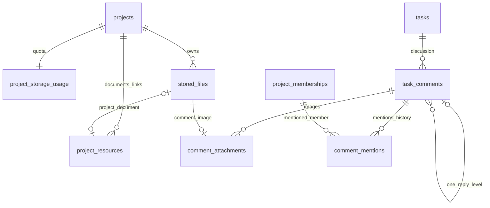

# Schema cộng tác và tài liệu dự án — RULE v2.0

## Phiên bản chuẩn

Nguồn nghiệp vụ: [RULE.md](../../RULE.md), cập nhật 28/10/2026. Schema chuẩn là toàn bộ chuỗi Flyway của từng service: Identity V1–V5, Work V1–V4, Notification V1–V4. Không sửa/xóa/squash migration đã có. [DATA_DICTIONARY.md](DATA_DICTIONARY.md) và [SCHEMA_CURRENT.sql](SCHEMA_CURRENT.sql) sinh từ MySQL đã migrate, không phải bộ DDL độc lập để chạy thay Flyway.

Có 38 bảng ứng dụng, chưa tính 3 bảng flyway_schema_history. Work V4 thêm 5 bảng; Identity V5 đã có user_avatars. Tài khoản và mọi cột tham chiếu tài khoản dùng CHAR(36) ASCII/binary, tài khoản mới sinh UUID v4. Các khóa nghiệp vụ khác giữ BIGINT. Không có FK/join chéo database.

## Ánh xạ rule → dữ liệu

| Nhóm rule | Lưu trữ | Bảo vệ ở database |
|---|---|---|
| COMMENT-01/02/05/08/13 | task_comments mở rộng | Nội dung hoặc ảnh; tối đa 2.000 ký tự; version; deleted_by; phản hồi cùng task, một cấp; unique khóa tạo theo dự án/tác giả/request |
| COMMENT-07/09/14/15 | stored_files + comment_attachments | Chỉ COMMENT_IMAGE thuộc cùng dự án, PNG/JPEG tối đa 5 MiB; slot 1–5 duy nhất/comment; tệp chỉ gắn một bình luận |
| COMMENT-10/11/12 | comment_mentions | Thành viên thuộc dự án, tối đa 10 slot đang hoạt động, một hàng/comment/user suốt vòng đời; lưu first_notified_at/eventId sau bỏ rồi thêm lại @ |
| FILE-01/02/05/06/14 | project_resources | FILE hoặc LINK; metadata, người tạo/xóa/version; file cùng dự án và đúng PROJECT_DOCUMENT; URL http/https không chứa userinfo; khóa chống tạo lặp |
| FILE-03/07/08/09/10/11 | stored_files | Danh sách MIME; tối đa 20 MiB/tệp dự án; storage key duy nhất, hash nội dung, request/hash chống tải lặp; trạng thái tải/xóa/dọn tệp và mốc 24 giờ |
| FILE-04 | project_storage_usage | used/reserved không âm; tổng không vượt 524.288.000 byte; version; backfill hàng hạn mức cho dự án đã tồn tại |
| COMMENT-04/11/12 và NOTI-06 | notifications + email_jobs | recipient_reasons; email task.comment.* chỉ cho REPLY/MENTION, gắn notification đúng người nhận/event; unique recipient/event giữ một inbox/một job |

MiB = 1.024 × 1.024 byte. 5 MiB = 5.242.880 byte; 20 MiB = 20.971.520 byte; 500 MiB = 524.288.000 byte. Không áp dụng mức 20 MiB của tài liệu dự án cho ảnh bình luận. Avatar nằm ngoài quota này.

## Quan hệ



### Phản hồi một cấp

Bình luận gốc có parent_comment_id=NULL, thread_level=0, parent_thread_level=NULL. Phản hồi có parent_comment_id của bình luận gốc, thread_level=1, parent_thread_level=0. FK `(project_id,task_id,parent_comment_id,parent_thread_level)` → `(project_id,task_id,id,thread_level)` ngăn tham chiếu sang task/dự án khác hoặc phản hồi cấp hai. Không xóa vật lý bình luận gốc; xóa logic giữ các phản hồi.

image_count là bộ đếm được ứng dụng giữ đồng bộ với comment_attachments. Body rỗng chuẩn hóa thành NULL khi chỉ gửi ảnh. CHECK cho phép ảnh-only thông qua image_count>0, nhưng không thể đếm hàng ở bảng khác. Backend bắt buộc gắn ảnh, cập nhật count và công bố bình luận trong cùng transaction; không coi CHECK đã chứng minh ảnh tồn tại.

Dữ liệu bình luận cũ được giữ nguyên, trở thành bình luận gốc; sinh creation_request_id và request_hash riêng cho dữ liệu cũ. Bình luận đã xóa được backfill deleted_by bằng tác giả vì rule trước V2.0 chỉ cho tác giả xóa. Không khôi phục nội dung đã xóa.

### @ và thông báo

comment_mentions lưu quan hệ theo user ID, không theo tên. slot_no từ 1 đến 10; active_slot sinh từ removed_at, nên unique `(comment_id,active_slot)` giới hạn 10 lượt @ đang hoạt động. Hàng đã bỏ @ được giữ và được tái kích hoạt, không INSERT hàng lịch sử mới hoặc xóa first_notified_at/eventId.

Khóa bình luận trước khi sửa @. Ghi first_notified_at/eventId bằng điều kiện `WHERE first_notified_at IS NULL` cùng transaction với outbox; chỉ ghi cho người thực sự được thông báo, loại chính actor. Bỏ rồi thêm lại @ không tạo event mới cho người đã thông báo. FK chỉ bảo đảm membership tồn tại, không bảo đảm ACTIVE hoặc quyền xem task: backend kiểm tra khi lưu và trước khi gửi.

Mỗi lần tạo/phản hồi là một eventId chung cho thao tác; hợp nhất từng recipient với mảng lý do ASSIGNEE/CREATOR/REPLY/MENTION. Không tạo event riêng cho mỗi lý do của cùng người trong cùng thao tác. Khi sửa, chỉ tạo sự kiện mới cho các lượt @ chưa từng được thông báo. Notification lưu một inbox/job mỗi recipient/event. recipient_reasons trên email và inbox phải lấy từ cùng audience đã được Work xác định, không nhận từ trình duyệt; CHECK không xác minh ai thực sự được trả lời/@.

Bình luận chỉ ASSIGNEE/CREATOR không có email. REPLY/MENTION có email TASK_EVENT và notification_id. Thay đổi tên event phải đồng bộ hợp đồng, migration và worker; không đổi tên để né kiểm tra `task.comment.%`.

## Giao thức dung lượng và tệp

1. Tạo dự án, Owner membership, quota row và activity trong cùng transaction. Migration backfill quota với 0 byte vì trước V4 chưa có tệp/ảnh bình luận; không tính metadata avatar cũ.
2. Upload writer khóa project, xác minh ACTIVE/quyền rồi khóa project_storage_usage FOR UPDATE. Kiểm tra request ID/hash để retry không giữ chỗ hai lần; giữ chỗ reserved_bytes trước khi nhận/lưu tệp.
3. Tạo stored_files với trạng thái UPLOADING, upload_request_id và request_hash. Đặt created_at một lần và temporary_expires_at chính xác +24 giờ. storage_key do server sinh, không lấy tên gốc làm đường dẫn. Mỗi request ID chỉ thuộc một payload; trùng ID nhưng hash khác trả 409.
4. Kiểm tra bytes thực tế, cấu trúc/MIME/đuôi, giới hạn và SHA-256 tại backend; ảnh cần giải mã an toàn. File bytes vật lý nằm ở Docker volume riêng của Work, database chỉ giữ metadata. Không tự giải nén ZIP hoặc thực thi nội dung; DOCX/XLSX/PPTX phải được kiểm tra container Office, không chỉ nhận vì là ZIP.
5. Khi file được xác nhận, chuyển READY và lưu ready_at/hash. File READY chưa attached vẫn là tệp tạm và chiếm reserved. Gắn ảnh hoặc tài liệu chỉ khi file READY, đúng người gửi/dự án/loại, chưa gắn nơi khác. Ghi quan hệ, attached_at, chuyển reserved → used và ghi history/outbox trong một transaction. READY chưa gắn không xuất hiện trong danh sách công khai của dự án.
6. Giữ khóa quota cho mọi thay đổi used/reserved, cộng trừ theo phép toán trên giá trị đang khóa. CHECK là lớp bảo vệ cuối cùng; không đọc số dư rồi ghi lại giá trị cũ ngoài transaction. Mọi writer dùng cùng thứ tự project → quota → comment/resource → file → mention; không gọi mạng hoặc ghi file lớn khi đang giữ khóa DB.
7. Xóa logic resource/comment/ảnh lập tức ngừng cấp quyền tải; chuyển file DELETE_PENDING, đặt deleted_at và purge_after=+24 giờ, giải phóng đúng một lần số byte đang used hoặc reserved theo trạng thái trước. Worker dọn vật lý và chuyển DELETED/purged_at; lỗi thì tiếp tục DELETE_PENDING để retry. Tệp đã mất trên volume được coi là dọn thành công, không trừ quota lần nữa.
8. Worker dọn cả upload FAILED và READY chưa gắn quá temporary_expires_at, hoàn lại reserved rồi xóa vật lý; không dọn READY đã gắn chỉ vì hết 24 giờ. Scheduler phải bảo đảm các mốc SLA theo rule; có cột thời gian không đồng nghĩa job đã chạy.
9. Đối soát định kỳ counters với metadata để phát hiện sai lệch; xử lý sai lệch dưới cùng khóa quota, không tự nới hạn mức. Sao lưu/khôi phục database và volume tại cùng mốc khi writer dừng; chỉ restore SQL không khôi phục được bytes.

Tệp đã xóa bị chặn ngay ở endpoint, kể cả nếu worker chưa xóa volume. Không trả storage_key như URL công khai. Download kiểm tra quyền hiện tại, Content-Type/nosniff và Content-Disposition theo rule. SQL CHECK URL chỉ kiểm tra hình dạng; backend phải parse URL tuyệt đối, cấm userinfo/giao thức nguy hiểm và không tự truy cập URL người dùng.

## Những điều schema không tự thực hiện

- Xác thực JWT/phiên, vai trò hiện tại, membership ACTIVE và dự án ARCHIVED.
- Không phản hồi bình luận đã xóa, không ghi vào dự án lưu trữ, sửa đúng tác giả/xóa đúng vai trò.
- Đồng bộ image_count với quan hệ ảnh, quota với metadata và trạng thái DB với volume.
- Đếm ảnh READY, kiểm tra virus/nội dung/đuôi thật, ngăn đường dẫn nguy hiểm và công khai tệp.
- Lưu history/outbox, phát realtime và gửi email chỉ khi người nhận còn quyền.
- Bất biến first-notified qua mọi đường sửa, idempotency khi cùng request ID khác payload, hoặc phiên bản sửa từ frontend.

Không thêm trigger gọi mạng hoặc trigger tự tính giờ/tiến độ. Các kiểm tra liên bảng và lịch chuyển trạng thái thuộc application service, cùng transaction/khóa. Entity hiện có không cần ánh xạ tất cả bảng/cột mới ngay; khi triển khai API tài liệu/bình luận phải dùng schema này, không tạo thêm schema V2 khác.

## Áp dụng và kiểm chứng

Với môi trường có dữ liệu: dừng writer/publisher/consumer; sao lưu cả ba database và volume tệp; kiểm tra phiên bản/checksum rồi chạy Flyway từ bản build mới. Nâng Work V4 và Notification V4 trước khi bật producer sự kiện bình luận mới. MySQL DDL tự commit: nếu dở dang, giữ writer dừng, khôi phục backup đã kiểm tra; không repair hoặc chạy lại mù quáng.

```sh
./mvnw -B verify
python3 scripts/test-schema.py --service-startup --export-docs
python3 scripts/test-project-foundation.py
```

Các script dùng database/container tạm, không đọc .env và không thay database đang dùng. Kiểm thử gồm nâng dữ liệu cũ, FK phản hồi/ảnh cùng task/dự án, giới hạn slot/bytes/quota, chống trùng upload/create/@, bảo toàn dấu đã nhắc, email theo lý do, cạnh tranh quota và Flyway/JPA validate sau khởi động lại. Không tự triển khai API ảnh/bình luận/tài liệu chỉ vì migration đã có.
