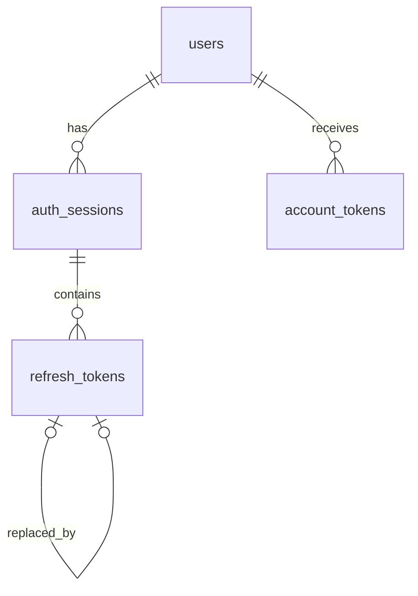
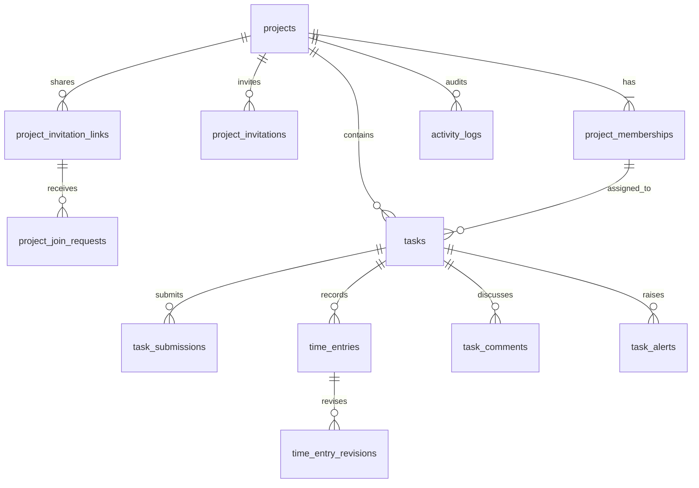
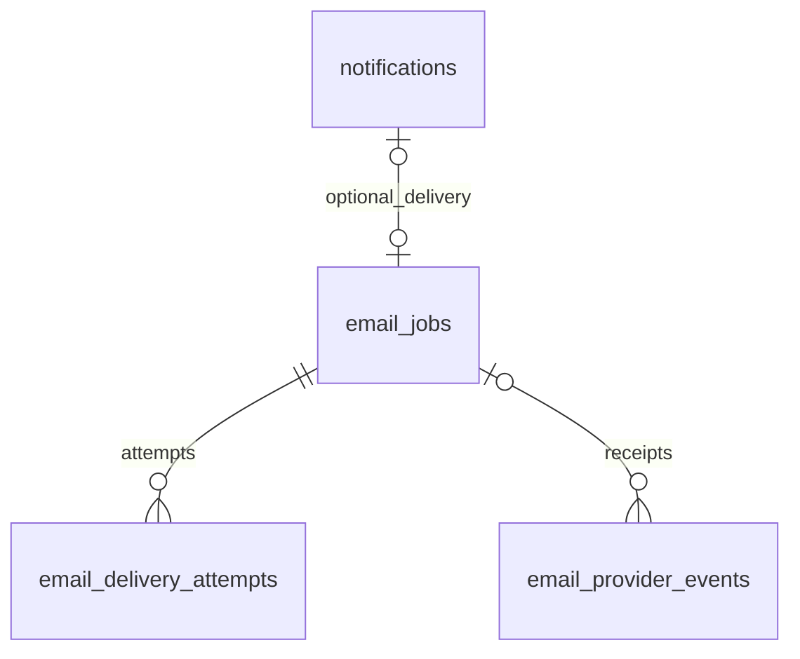

# Schema dữ liệu TaskNest

Bộ schema khởi tạo mới cho toàn dự án, dùng MySQL 8.4/InnoDB và Flyway. Phạm vi bao gồm tài khoản/JWT, dự án/thành viên, lời mời/link/QR, nhiệm vụ/Kanban, duyệt kết quả, ghi giờ/điều chỉnh, cảnh báo, bình luận/lịch sử, dashboard, thông báo trong ứng dụng và email Brevo. Phiên bản hiện tại có ảnh bình luận/phản hồi, @thành viên và tệp/liên kết cấp dự án; chưa có tệp tùy ý trong bình luận nhiệm vụ, Gantt, ngân sách hoặc công việc lặp.

Cơ sở nghiệp vụ là [RULE v2.0](../../RULE.md), đối chiếu ngày 28/10/2026. RULE.md ở gốc repository là bản dùng chung cho nhóm; mẫu SRS cũ không ghi đè các bổ sung mới trong rule. Các chi tiết lưu trữ trong tài liệu này là thiết kế triển khai các yêu cầu đó, không phải yêu cầu lấy từ đề tài mẫu. DDL không tự triển khai REST API, phân quyền, publisher/consumer hoặc scheduler. Phần API tạo dự án và auth đã có code riêng; các bảng cộng tác/tài liệu mới đang chuẩn bị cho bước triển khai API.

## 1. Phân chia dữ liệu

| Database | Service sở hữu | Bảng nghiệp vụ | Bảng hạ tầng chung | Tổng, gồm marker V1 |
|---|---|---:|---:|---:|
| `tasknest_identity` | Identity | 6 | 2 | 9 |
| `tasknest_work` | Work Management | 18 | 2 | 21 |
| `tasknest_notification` | Notification | 5 | 2 | 8 |

Tổng **38 bảng ứng dụng**, gồm 29 bảng nghiệp vụ, 6 bảng outbox/deduplication và 3 marker `service_metadata`. Mỗi database có thêm flyway_schema_history, không tính trong 38 bảng. [Từ điển dữ liệu](DATA_DICTIONARY.md) và [DDL snapshot hiện tại](SCHEMA_CURRENT.sql) được sinh từ MySQL sau toàn bộ migration bằng `python3 scripts/test-schema.py --export-docs`. Snapshot chỉ để tra cứu; triển khai luôn dùng Flyway.

- Mỗi service có database/tài khoản riêng theo `infra/mysql/init/01-databases.sh`. Không FK, join hoặc truy vấn chéo database. Gateway, Eureka, Config không sở hữu database nghiệp vụ.
- Identity là nguồn chính của tài khoản và phiên. Work là nguồn chính của quyền dự án và toàn bộ dữ liệu công việc. Notification chỉ lưu bản chiếu liên hệ để gửi thông báo, không dùng nó để cấp quyền.
- ID tài khoản `users.id` và mọi tham chiếu người dùng ở ba service dùng `CHAR(36)` ASCII phân biệt hoa/thường; tài khoản mới sinh UUID v4 tại backend. Đây là khóa chính trực tiếp, không có `public_id`. Các ID nghiệp vụ khác vẫn dùng `BIGINT` tự tăng; UUID sự kiện/phiên/refresh token giữ nguyên. Xem [kế hoạch chuyển ID tài khoản](UUID_ACCOUNT_IDS.md) trước khi nâng cấp database có dữ liệu.
- Các thời điểm dùng `DATETIME(6)` theo UTC; kết nối JDBC/worker phải đặt UTC. Ngày nghiệp vụ dùng `DATE`, diễn giải theo `Asia/Ho_Chi_Minh`. MySQL không tự chuyển timezone cho DATETIME.
- Tên dùng `utf8mb4_0900_as_ci`: không phân biệt hoa/thường nhưng phân biệt dấu tiếng Việt. Generated column `TRIM(name)` cùng unique index thực thi quy tắc trùng tên. Backend chuẩn hóa khoảng trắng Unicode và kiểm tra email đúng định dạng; SQL TRIM chỉ xử lý dấu cách thông thường.
- Trạng thái là VARCHAR ASCII phân biệt hoa/thường kèm CHECK. Không dùng ordinal của Java enum. `version` phục vụ optimistic locking; cập nhật phải tăng version và cập nhật `updated_at` trong backend (không có trigger tự làm).
- Không lưu tổng giờ, phần trăm hoàn thành, nhãn quá hạn hoặc theme vào user/task. Theme lưu ở trình duyệt; chỉ số được tính từ dữ liệu gốc. Không lưu ảnh QR: tạo từ URL chứa `public_code` hiện hành. Avatar cá nhân hiện được chuẩn hóa và lưu trong bảng user_avatars của Identity V5. Ảnh dự án dùng metadata hiện có trên projects. Ảnh bình luận và tài liệu do Work quản lý qua stored_files với tệp vật lý trên Docker volume riêng, không dùng URL công khai; backend kiểm tra SEC-12. Avatar không tính vào hạn mức tài liệu dự án.

## 2. Migration và khởi tạo

**Thành viên vừa pull code:** dùng [quy trình nâng schema](TEAM_SCHEMA_UPGRADE.md). Script nâng cấp giữ nguyên Compose override/cổng của từng máy, kiểm tra backup trên MySQL tạm trước khi migrate thật.

| Service | Migration hiện hành | Nội dung mới nhất |
|---|---|---|
| Identity | V1 → V5 | UUID trực tiếp ở V4; hồ sơ/avatar ở V5 |
| Work | V1 → V4 | V3 UUID; V4 phản hồi/ảnh/@thành viên/tài liệu/quota |
| Notification | V1 → V4 | V3 UUID; V4 lý do người nhận và email phản hồi/@ |

Giữ nguyên migration đã chia sẻ/áp dụng. Work V4 và Notification V4 là nâng cấp tiếp nối; Identity không cần migration mới cho nghiệp vụ tài liệu dự án. Không ghép hai bộ V2 từ nhánh cũ, không dùng repair, sửa checksum hoặc xóa volume để bỏ qua xung đột. MySQL DDL tự commit; phải sao lưu trước khi áp dụng lên môi trường có dữ liệu. Hướng dẫn chi tiết: [cộng tác và tài liệu](COLLABORATION_AND_FILES.md).

Với môi trường mới của dự án, tạo cấu hình local rồi build/chạy theo hướng dẫn repository:

```sh
python3 scripts/setup-local.py
./mvnw -B verify
./scripts/compose.sh up -d --build
```

Flyway của mỗi service áp dụng toàn bộ migration theo thứ tự vào đúng database được cấp. Không chạy SQL root vào database khác; không đặt toàn bộ DDL trong script init MySQL vì các volume đã tồn tại sẽ không chạy lại init. Tiếp tục dùng `ddl-auto=validate`, không dùng `update`.

DDL MySQL có implicit commit; nếu V2 lỗi giữa chừng trên môi trường thử nghiệm mới, kiểm tra nguyên nhân và tái tạo **chỉ database thử nghiệm đó**, không chạy lại mù quáng hoặc xóa dữ liệu đang sử dụng. Sau khi migration đã được chia sẻ/áp dụng, mọi thay đổi tiếp theo phải có số phiên bản mới của đúng service.

Kiểm thử độc lập, không đọc `.env` và không dùng database đang chạy:

```sh
python3 scripts/test-schema.py
```

Script cần Docker và image `mysql:8.4` (Docker có thể tải nếu chưa có). Nó tự tạo container tên ngẫu nhiên, không mở port, không gắn volume, không nối mạng; chạy DDL và kiểm tra ràng buộc/lịch sử/ghi đồng thời rồi xóa chính container đó. Mặc định đây là kiểm thử DDL trực tiếp bằng MySQL client. Để kiểm tra tích hợp với các service đã build, dùng Java 21:

```sh
python3 scripts/test-schema.py --service-startup
```

Chế độ này mở cổng MySQL thử nghiệm ngẫu nhiên chỉ trên loopback; khởi động lần lượt JAR Identity, Work và Notification với tài khoản riêng từng database, để Flyway thực sự áp dụng toàn bộ migration hiện hành, rồi khởi động lại để kiểm tra validate/checksum. Cấu hình datasource/Flyway/JPA lấy từ Config Repo của từng service; Config Server, Eureka và RabbitMQ được tắt trong phép thử database này. Sau đó chạy cùng các kiểm tra ràng buộc. Các service dùng cổng ứng dụng/management ngẫu nhiên trên loopback và được dừng sau kiểm tra; container bị xóa cùng vùng dữ liệu tmpfs. CI chạy chế độ này sau Maven build.

Work đã có entity và API tạo dự án; kiểm tra riêng bằng `python3 scripts/test-project-foundation.py` sau khi build JAR. Schema có cấu trúc cho chức năng mới không có nghĩa API phản hồi/@/tài liệu đã được triển khai. CHECK/FK không thay thế phân quyền, kiểm tra nội dung tệp hoặc cập nhật outbox/quota trong transaction.

## 3. Identity



| Bảng | Nội dung và quy tắc |
|---|---|
| `users` | Email chuẩn hóa duy nhất; họ tên 2–100 ký tự; mật khẩu băm; trạng thái/thời điểm xác nhận; metadata ảnh; version. Không có cột mật khẩu gốc, role dự án hay theme. Email bất biến qua API phiên bản đầu. |
| `auth_sessions` | Một phiên cho một thiết bị đăng nhập, thuộc user; hạn tuyệt đối tối đa 7 ngày; lần truy cập gần nhất; thu hồi/lý do. Cho phép nhiều phiên cùng user. |
| `refresh_tokens` | Lưu băm SHA-256 32 byte của token ngẫu nhiên đủ mạnh; thuộc một phiên, mốc dùng/thu hồi, liên kết token thay thế cùng phiên. Unique generated key chỉ cho một token chưa dùng/chưa thu hồi trong một phiên. Hạn dùng lấy từ phiên, không trượt thêm 7 ngày sau rotation. |
| `account_tokens` | Băm token xác nhận email hoặc đặt lại mật khẩu; cấp/hết hạn/dùng/thu hồi. Mỗi user chỉ có một token hiện hành cho mỗi purpose; xác nhận email tối đa 24 giờ. Reset TTL lấy cấu hình riêng. |
| `auth_rate_limit_buckets` | Bộ đếm theo action/scope/băm chủ thể/cửa sổ. Dùng atomic upsert, dọn theo `window_end`. Không lưu email/IP nguyên dạng để làm khóa giới hạn. |

Xác nhận email: ghi user, account token và outbox trong cùng transaction. Gửi lại khóa user/token, kiểm tra 60 giây và tối đa 5 lần/giờ, thu hồi token cũ, tạo token mới và outbox. Cần cửa sổ trượt hoặc đếm lịch sử cấp để không vượt 5 lần/giờ ở ranh giới cửa sổ; bảng bucket là công cụ bổ trợ, không tự thực thi giới hạn. Token hết hạn nhưng chưa đánh dấu vẫn chiếm unique key: dịch vụ phải thu hồi trước khi cấp mới, không đưa `NOW()` vào generated column.

Refresh: khóa `auth_sessions ... FOR UPDATE`, kiểm tra chưa thu hồi/chưa hết hạn; tìm token theo băm. Nếu token đã dùng, thu hồi toàn phiên và kết thúc transaction thu hồi thành công trước khi trả lỗi xác thực. Không ném exception làm rollback việc thu hồi. Nếu hợp lệ: đánh dấu token cũ đã dùng, chèn token mới, gắn `replaced_by_id`, commit; chỉ trả cookie mới sau commit. Mọi request refresh/thu hồi của cùng phiên dùng cùng khóa. Giữ token đã dùng đủ lâu để phát hiện replay; unique key không thay thế khóa transaction.

Access Token mới có hạn `min(now + 15 phút, session.expires_at)`. API và realtime kiểm tra trạng thái phiên hiện tại để logout có hiệu lực ngay; không chỉ kiểm chữ ký JWT. Không tạo bảng Access Token. Đổi/reset mật khẩu và chính sách thu hồi phiên phải tuân hợp đồng bảo mật khi triển khai; schema hỗ trợ thu hồi từng phiên/tất cả phiên, không tự quyết định chính sách.

## 4. Work Management



ERD thể hiện quan hệ nghiệp vụ; điều kiện Owner luôn là thành viên phải được thực thi trong transaction, không có FK vòng bắt buộc từ projects tới memberships.

| Bảng | Nội dung và quy tắc |
|---|---|
| `projects` | Owner duy nhất, Manager tùy chọn khác Owner, tên/mô tả/lịch dự kiến/ảnh, trạng thái ACTIVE/ARCHIVED và mốc lưu trữ. Tên hoạt động duy nhất trong phạm vi Owner. |
| `project_memberships` | PK `(project_id,user_id)`, chuyên môn, ACTIVE/REMOVED, mốc/người thêm/xóa. Không xóa vật lý. Tái tham gia cập nhật lại hàng này và ghi activity; lịch sử các lần tham gia nằm trong activity_logs. |
| `project_invitations` | Lời mời trực tiếp gắn user đã đăng ký/xác nhận; người mời; hạn chính xác 7 ngày; PENDING/ACCEPTED/REJECTED/CANCELLED/EXPIRED; mỗi cặp project/user có tối đa một PENDING. |
| `project_invitation_links` | Mã công khai ngẫu nhiên 256 bit biểu diễn 64 ký tự hex, ACTIVE/REVOKED; tối đa một link ACTIVE/project; không tự hết hạn. Code này chỉ mở cổng xin tham gia, không phải token đăng nhập. Lưu code để sao chép/tạo QR; tránh log/đưa vào analytics. |
| `project_join_requests` | Người xin, link gốc thuộc đúng dự án, lý do tùy chọn ≤500 ký tự, PENDING/ACCEPTED/REJECTED/CANCELLED/CLOSED; tối đa một PENDING/project/user. Giữ yêu cầu khi link bị thay thế. Index phục vụ kiểm tra từ chối gần nhất theo user/project. |
| `tasks` | Tên duy nhất trong dự án, người tạo/phụ trách tham chiếu membership đúng project, ưu tiên, 5 trạng thái, lịch, ước tính giây >0, blocked/lý do, version và liên kết lần nộp hiện tại. Deadline ngoài lịch dự án vẫn được lưu; backend trả cảnh báo. |
| `task_submissions` | Mỗi lần gửi duyệt có số thứ tự riêng, người nộp và người phụ trách tại lúc nộp, ghi chú kết quả, deadline snapshot, mốc nộp và quyết định/người/mốc/lý do duyệt. Tối đa một lần PENDING/task. |
| `time_entry_locks` | Một hàng mutex/user dùng chung cho mọi project/task, phục vụ kiểm tra không chồng lấn. Không phải dữ liệu phiên đăng nhập; không xóa sau mỗi lần ghi giờ. |
| `time_entries` | TIMER/MANUAL, người thực hiện, khoảng UTC, lý do nhập tay, người tạo/cập nhật/version. Unique generated key bảo đảm một timer chạy/user trên toàn Work. Thời lượng đóng tính bằng microsecond, không cộng số giây frontend. |
| `time_entry_revisions` | Trước/sau của khoảng giờ, người sửa, thời điểm, lý do bắt buộc; giữ cả NULL biểu diễn phiên đang chạy. Không thay thế lịch sử bằng giá trị mới. |
| `task_comments` | Nội dung 1–2.000 ký tự, tác giả, mốc tạo/sửa/xóa/version. Khi xóa: body=NULL, giữ hàng/tác giả/mốc để hiển thị dấu đã xóa. |
| `activity_logs` | Lịch sử chỉ ghi thêm, entity/action/version, người thao tác (NULL nếu hệ thống), dữ liệu trước/sau và lý do. Không ghi bí mật/token. Backend không cung cấp API sửa/xóa history. |
| `task_alerts` | Sổ chống gửi lặp; RISK/OVERRUN/OVERDUE một lần/type/task kể cả mở lại hoặc sửa ước tính; DUE_SOON chống gửi lặp theo deadline_on_snapshot (nhắc lại một lần nếu dời sang deadline mới). REVIEW_OVERDUE gắn lần nộp để nhắc đúng vòng duyệt; đây là lựa chọn dedupe kỹ thuật cho nhắc duyệt. Giữ số liệu snapshot để giải thích cảnh báo. |

Vai trò chỉ có **một nguồn chính**: `projects.owner_user_id`, `projects.manager_user_id`. Với thành viên ACTIVE, user=Owner ⇒ OWNER, user=Manager ⇒ MANAGER, còn lại ⇒ MEMBER. Không thêm `membership.role` hoặc quyền toàn cục trong JWT để thay thế nguồn này. Tạo project + owner membership cùng transaction; chỉ định Manager phải kiểm tra membership ACTIVE, Owner không được thay/xóa. FK membership trên task chỉ bảo đảm hàng tồn tại, không bảo đảm còn ACTIVE.

### Transaction và ghi đồng thời

| Thao tác | Kiểm tra và ghi trong cùng transaction Work |
|---|---|
| Mọi thay đổi dự án | Khóa project, xác minh ACTIVE và quyền hiện tại. Lưu trữ chỉ Owner, không còn timer chạy. Khi mở lại kiểm tra xung đột unique tên. |
| Chấp nhận lời mời | Khóa project rồi invitation; kiểm tra đúng tài khoản, chưa thành viên, PENDING và `now < expires_at`; chuyển ACCEPTED, tạo/khôi phục membership, đóng join request PENDING với lý do DIRECT_INVITATION_ACCEPTED, ghi history + outbox. Không cần duyệt lần hai. |
| Mời lại | Đánh dấu EXPIRED các lời mời cũ hết hạn trước khi INSERT mới; unique PENDING không phụ thuộc đồng hồ DB. |
| Xin tham gia | Khóa project và link; kiểm tra ACTIVE, chưa thành viên, không PENDING, lần REJECTED gần nhất cách ít nhất 24 giờ theo project/user kể cả link khác; chèn yêu cầu + outbox. Khóa project tuần tự hóa cả quyết định từ chối và gửi lại. |
| Duyệt yêu cầu | Khóa project/request; không yêu cầu link gốc còn ACTIVE; cập nhật trạng thái và membership cùng transaction; không để redelivery tạo thành viên trùng. |
| Gửi duyệt | Kiểm tra trạng thái/quyền/version; dừng timer nếu có, ghi submission PENDING với deadline snapshot, gắn latest_submission_id, chuyển IN_REVIEW, history + outbox. |
| Duyệt kết quả | Khóa task/submission, kiểm tra latest PENDING, lưu ACCEPTED/người/mốc, gắn accepted_submission_id và completed_at; chuyển DONE. FK chỉ bảo đảm đúng task; backend bảo đảm quyết định là ACCEPTED và là lần nộp hiện hành. |
| Yêu cầu làm lại | Lý do bắt buộc; submission thành REJECTED, task trở về IN_PROGRESS; lần nộp sau tạo hàng mới, không sửa ghi chú/deadline của lần trước. |
| Mở lại | Lưu lý do/history; task về IN_PROGRESS, xóa accepted_submission_id/completed_at hiện tại; giữ mọi submission/quyết định cũ. |
| Hủy/phân công lại | Kiểm tra trạng thái/quyền và membership mới; dừng timer với thời điểm máy chủ, giữ user_id của giờ đã làm; history + outbox. Không xóa task. |
| Xóa thành viên | Chỉ Owner, không Owner, không còn task chưa DONE/CANCELLED đang phụ trách. Thu hồi Manager nếu liên quan; đánh dấu REMOVED; history + outbox để realtime thu hồi quyền ngay. |
| Sửa task/comment | Dùng `UPDATE ... WHERE id=? AND version=?`, tăng version. Không cập nhật được hàng nào thì trả xung đột; kiểm tra quyền tác giả khi sửa comment; tác giả hoặc Owner/Manager khi xóa. Quy tắc ảnh/phản hồi/nhắc tên theo Work V4 và tài liệu cộng tác. |
| Phát cảnh báo | Worker kiểm tra điều kiện mới nhất, chèn task_alerts và outbox cùng transaction; duplicate unique key nghĩa đã tạo cảnh báo. Nhảy <80% lên >100% chỉ tạo OVERRUN ở lần đó. |

### Không chồng lấn giờ làm

MySQL CHECK/unique không đủ để cấm hai khoảng giờ bất kỳ chồng nhau. Backend bắt buộc dùng cùng giao thức cho Bắt đầu/Dừng, nhập tay/sửa giờ và dừng tự động:

1. Khóa các project liên quan theo ID tăng dần, rồi các task theo ID tăng dần; tái kiểm tra quyền/trạng thái. Mỗi thao tác chỉ giữ các khóa project/task đã xác định trước, không lấy thêm project/task sau khóa user.
2. Khóa mutex của mọi user liên quan theo user ID tăng dần: `INSERT IGNORE INTO time_entry_locks(user_id) VALUES (?)`, rồi `SELECT user_id ... FOR UPDATE`. Không lấy mutex trước rồi chờ project/task (tránh khóa ngược). Nếu không xác định được tập khóa do dữ liệu thay đổi, rollback và thử lại hữu hạn từ đầu.
3. Sau mutex, đọc các time_entries của user trên **mọi project** bằng locking read `SELECT ... FOR UPDATE` để thấy dữ liệu vừa commit, kể cả khi isolation mặc định REPEATABLE READ. Với khoảng `[start,end)`, giao nhau khi `existing.started_at < end AND (existing.ended_at IS NULL OR existing.ended_at > start)`, bỏ chính hàng đang sửa. TIMER mới có end=+∞; không dựa vào giờ frontend. Khoảng rỗng start=end không tiêu thụ thời gian, xử lý riêng khi kiểm tra giao nhau.
4. Kiểm tra không ở tương lai, đúng người thực hiện và điều kiện TIME; ghi thay đổi + revision nếu điều chỉnh + history/outbox; commit. Ghi tay phải có end và lý do. Owner/Manager chỉ được dừng do chuyển trạng thái/phân công, không sửa thay giờ người khác.

Giữ khóa project lâu có thể hạn chế song song nhưng phù hợp quy mô sinh viên, dễ kiểm chứng. Service phải xử lý deadlock bằng rollback/retry hữu hạn, không retry gửi email trực tiếp trong transaction. Không xóa mutex theo job cleanup khi còn request có thể dùng nó. `uq_time_running_user` là lớp bảo vệ cuối cùng cho timer, không thay thế kiểm tra khoảng đóng.

Không có FK từ time_entries tới auth_sessions: đăng xuất/thu hồi/hết hạn 7 ngày không dừng timer. Timer chạy cần tính theo thời gian máy chủ khi tải lại; không cần UPDATE mỗi giây.

## 5. Notification và Brevo



| Bảng | Nội dung và quy tắc |
|---|---|
| `recipient_contacts` | Projection email/tên/trạng thái xác nhận và version nguồn Identity. Chỉ áp dụng event có version mới hơn; thiếu projection thì trì hoãn hoặc tra cứu Identity bằng hợp đồng nội bộ. Không FK bắt buộc để tránh mất email xác nhận lúc event khác thứ tự. |
| `notifications` | Inbox bền vững, người nhận/event/type, actor, project/task/resource, tiêu đề/nội dung, read_at. Unique recipient/event loại trùng vai trò và redelivery. Chỉ người nhận đánh dấu đọc. |
| `email_jobs` | Hàng đợi email, địa chỉ snapshot, template/version/data, purpose, liên kết notification tùy chọn, retry/lease và trạng thái provider. Composite FK bảo đảm nếu gắn notification thì cùng người nhận/event. Email xác nhận/reset không bắt buộc có inbox notification. |
| `email_delivery_attempts` | Từng lần gọi provider, mốc bắt đầu/kết thúc, kết quả và lỗi an toàn; UNKNOWN dùng khi không xác định provider đã nhận hay chưa. Không lưu raw request/response có link token. |
| `email_provider_events` | Biên nhận provider, message ID, loại/mốc sự kiện, hash chống trùng và job nếu đã đối chiếu được. Hỗ trợ webhook tới sớm/chưa tìm thấy job, xử lý thứ tự đến khác thứ tự phát sinh. |

Worker claim bằng transaction ngắn/lease, gọi Brevo ngoài transaction, cập nhật kết quả theo chủ sở hữu lease. Retry hữu hạn lỗi tạm thời với backoff, hết hạn chuyển FAILED, thư không còn hợp lệ chuyển SUPPRESSED. Khi provider nhận yêu cầu ghi ACCEPTED; chỉ ghi DELIVERED khi có biên nhận tương ứng, không coi ACCEPTED là vào hộp thư. Không chuyển từ DELIVERED về ACCEPTED do webhook muộn. Xác thực webhook, đối chiếu provider/message/job và băm dedupe theo thông tin ổn định đã xác minh; không tin job ID client gửi.

Unique job ngăn ứng dụng tạo hai email cho cùng event/người nhận; không tự bảo đảm gửi bên ngoài đúng một lần khi timeout sau khi provider đã nhận. Kết quả không rõ phải đối chiếu provider hoặc dùng idempotency được provider hỗ trợ trước khi gửi lại; không retry mù vì lease hết hạn. Đây là trách nhiệm tích hợp Brevo, chưa có worker trong thay đổi schema.

Recipient audience do service nguồn xác định đúng rule NOTI/COMMENT, loại người trùng. Với mọi event task.comment.*, email chỉ được tạo nếu recipient_reasons có REPLY hoặc MENTION, purpose=TASK_EVENT và có notification cùng người nhận/event. Người chỉ có lý do ASSIGNEE/CREATOR nhận trong ứng dụng. Worker phải gộp lý do/người nhận từ service nguồn và kiểm tra quyền trước khi gửi; xem Notification V4. Project events gửi tới email đã xác nhận; xác nhận đăng ký là ngoại lệ. Thông báo bị xóa khỏi dự án không chứa dữ liệu nội bộ, trang đích luôn kiểm tra quyền hiện tại. Không lưu URL bên ngoài do người dùng tùy ý nhập làm đích điều hướng.

## 6. Outbox, bảo mật và nhất quán liên service

Mỗi database có `outbox_events` và `processed_events` riêng. Ghi dữ liệu + activity + outbox cùng transaction tại service nguồn. Publisher claim bằng lease, gửi RabbitMQ persistent với publisher confirm, rồi đánh PUBLISHED; crash có thể phát lặp. Consumer chèn khóa `(consumer_name,event_id)` trong **cùng transaction** với tác động nghiệp vụ/inbox/email job, chỉ ACK sau commit; rollback phải bỏ cả dấu xử lý. Hai consumer khác tên vẫn được xử lý cùng event độc lập. EventId giữ nguyên khi retry/redelivery; không tạo UUID mới mỗi lần gửi lại.

Payload gồm aggregate ID/version, loại/schema_version, UTC occurred_at, correlation ID; không dùng thứ tự delivery làm thứ tự nghiệp vụ. `correlation_id` tùy chọn là UUID do hệ thống tạo; nếu nhận correlation header dạng khác, chuẩn hóa hoặc sinh UUID rồi giữ mapping trong log an toàn. Consumer projection dùng source_version để chống event cũ. Có DLQ và retry hữu hạn theo cấu hình hệ thống.

Các token xác nhận/reset/refresh được lưu **băm** ở bảng xác thực. Tuy nhiên dịch vụ gửi mail cần khôi phục token trong liên kết: phần giao nhận nhạy cảm phải được mã hóa ở tầng ứng dụng trong `outbox_events.sensitive_payload` và `email_jobs.sensitive_data`, kèm key ID. Dùng authenticated encryption và envelope/version của ứng dụng; khóa ở ngoài DB/Git/frontend, truyền nội bộ an toàn. JSON `payload`/`template_data` chỉ giữ dữ liệu không bí mật; không nhét URL token nguyên dạng vào JSON, log, lỗi hoặc activity. DDL chỉ cung cấp cột chứa ciphertext, không tự mã hóa và không ngăn ứng dụng ghi plaintext sai cách. Sau khi xử lý thành công/hết hạn, xóa ciphertext theo chính sách lưu giữ để giảm phơi lộ; lưu hash/metadata cần cho đối chiếu/replay. Không xóa dấu processed_events sớm hơn thời hạn hệ thống có thể replay sự kiện.

Không xóa vật lý project/task/membership/submission/time để né ràng buộc lịch sử. Không có `ON DELETE CASCADE`. Cần quy trình backup/khôi phục, quyền DB và retention vận hành riêng. Không có tài khoản mẫu hoặc mật khẩu hardcode trong migration. Thuật toán băm mật khẩu/JWT, reset TTL, dung lượng ảnh, sender/domain/key Brevo vẫn thuộc cấu hình/hợp đồng kỹ thuật khi thực hiện tính năng; schema không chọn thay các giá trị này.

## 7. Dashboard, deadline và truy vấn

- Danh sách/Kanban dùng chung tasks và trạng thái TODO/IN_PROGRESS/IN_REVIEW/DONE; CANCELLED chỉ qua lọc danh sách. Bộ lọc áp dụng trước phân trang (10/20/50), thứ tự ổn định thêm ID; backend không tính số liệu từ một trang dữ liệu.
- Tiến độ hiện tại = `COUNT(status='DONE') / COUNT(status<>'CANCELLED')`; mẫu số 0 trả NULL/Chưa có nhiệm vụ. Biểu đồ ngày/tuần tính `COUNT(DISTINCT task_id)` trên submission ACCEPTED theo reviewed_at trong kỳ. Một task có thể được duyệt ở các kỳ khác nhau sau mở lại; trong một kỳ không đếm hai lần.
- Thời gian thực tế = tổng duration_microseconds của phiên đóng + `now - started_at` của phiên đang chạy, đổi sang giờ khi hiển thị. Member chỉ nhận thời gian của mình đúng quyền; không gửi tổng giờ người khác vào API/tooltip để frontend tự ẩn.
- Quá hạn thực hiện chỉ TODO/IN_PROGRESS; IN_REVIEW là nhắc chờ duyệt sau deadline. So hạn với ngày hiện tại Việt Nam. Đúng/trễ hạn hoàn thành so submitted_at của accepted_submission với **deadline_on_snapshot**, không so reviewed_at hoặc deadline mới.
- Deadline 01/11/2026 kết thúc ngay trước `2026-11-02 00:00:00+07:00`, tương đương ranh giới UTC `2026-11-01 17:00:00Z`. Nộp trước ranh giới là đúng hạn. Chuyển ranh giới ở Java ZoneId để tránh phụ thuộc MySQL timezone tables.
- Index sẵn có hỗ trợ inbox chưa đọc, nhiệm vụ project/status/deadline, task theo assignee, lịch sử, hết hạn lời mời/token và hàng đợi. Tìm chuỗi con `%từ khóa%` vẫn có thể quét phạm vi project; chưa thêm FULLTEXT do cần kiểm chứng cách tìm tiếng Việt. Đo EXPLAIN trên dữ liệu thực trước khi bổ sung index, không tạo bảng thống kê thứ hai làm lệch nguồn.

Xem [DATA_DICTIONARY.md](DATA_DICTIONARY.md) để tra từng cột, kiểu, NULL, giá trị mặc định và generated expression. SQL migration là nguồn chuẩn cho CHECK/FK/index. Việc đáp ứng quy tắc nghiệp vụ cần cả schema và transaction backend mô tả ở trên.

## 7. Cộng tác và tài liệu — RULE v2.0

Work V4 bổ sung project_storage_usage, stored_files, project_resources, comment_attachments, comment_mentions; mở rộng task_comments bằng phản hồi một cấp, ảnh, người xóa và chống tạo lặp. Notification V4 cho phép email cho người được phản hồi/@ với recipient_reasons, giữ unique người nhận/sự kiện. Xem [thiết kế và transaction bắt buộc](COLLABORATION_AND_FILES.md).
