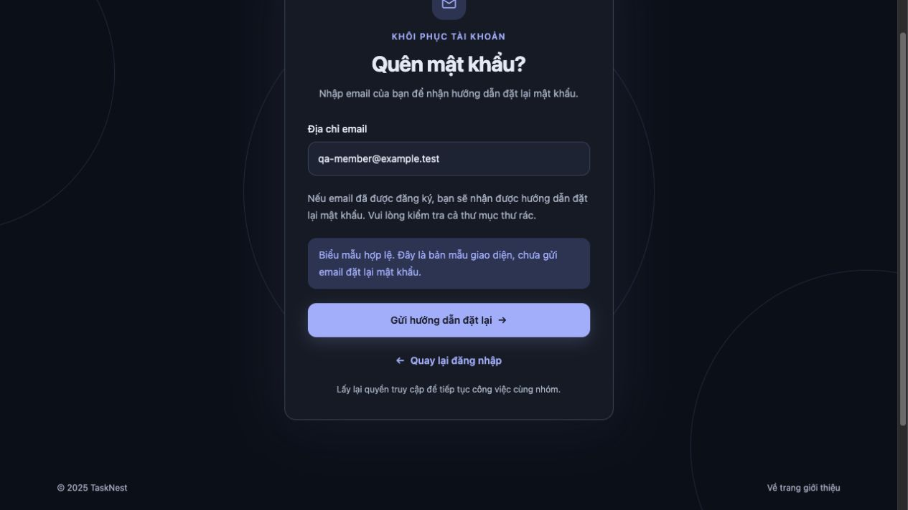
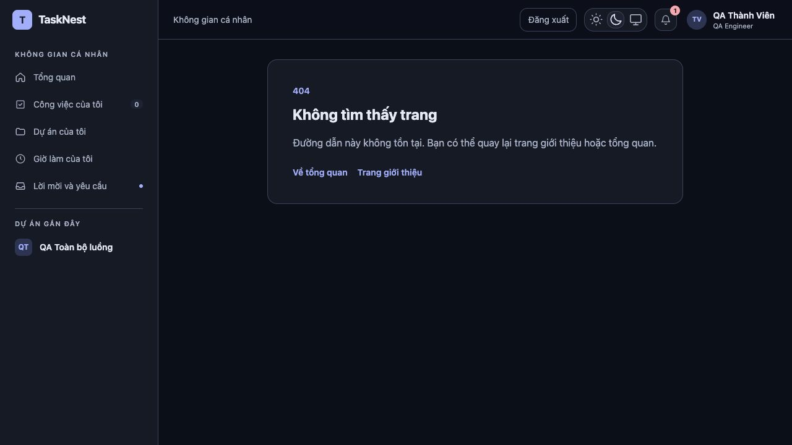
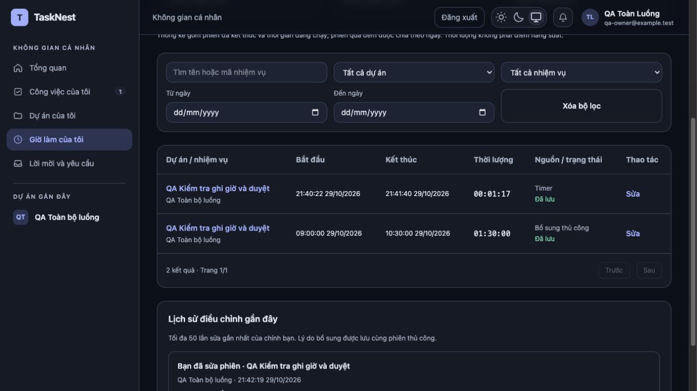

# Báo cáo kiểm thử TaskNest — 29/10/2026

## Kết luận

Kiểm thử trên `main`, commit `9a193cd`. Các bộ kiểm thử hiện có đều qua, nhưng ứng dụng **chưa hoàn thành toàn bộ RULE/SRS**. Quên mật khẩu còn là giao diện mẫu; realtime, thông báo nghiệp vụ đầy đủ và một số chức năng nhiệm vụ/cộng tác chưa được triển khai.

Không thay đổi mã nghiệp vụ, không commit/push trong đợt kiểm thử này. Chỉ bổ sung báo cáo và ảnh bằng chứng.

## Môi trường và cách kiểm thử

- macOS, Java 21, React/Vite, MySQL 8.4.9, RabbitMQ.
- Tạo database/container riêng và tài khoản `example.test`; không thay đổi database đang sử dụng hoặc cấu hình `.env`.
- Kiểm thử API tích hợp qua Java service thật. Bộ workspace dùng Identity contract stub; bộ auth/member và lượt trình duyệt dùng Identity thật.
- Trình duyệt chạy frontend hiện tại ở cổng 5188, qua Gateway đến Identity/Work/Notification thật và MySQL/RabbitMQ riêng. Cấu hình discovery tĩnh chỉ áp dụng cho môi trường thử này.
- Brevo được thay bằng HTTP server kiểm thử: kiểm chứng request, hàng đợi, retry và xử lý sự kiện; không kiểm chứng email đến Gmail hay dịch vụ Brevo thực tế.
- Lỗi 503 ở lần dựng môi trường UI đầu tiên do thiếu cấu hình discovery Identity của harness; đã sửa harness và kiểm tra lại các API trả 200. Không tính là lỗi ứng dụng.

## Kết quả tự động

| Nhóm | Lệnh | Kết quả |
| --- | --- | --- |
| Frontend | `npm run typecheck`, `npm run lint`, `npm test -- --run`, `npm run build` | Đạt; 26 file, 114 test |
| Backend | `./mvnw -B verify` với Java 21 | Đạt; 126 test, 0 lỗi, 0 bỏ qua |
| Rate-limit test helper | `python3 -m unittest discover -s scripts -p 'test_rate_limit_checks.py'` | 4 test đạt |
| Dependency | `python3 scripts/check-java-dependencies.py` | 137 metadata package, OSV không trả hit trong lượt kiểm tra |
| Auth/mail/member | `python3 scripts/test-project-members.py` | Đạt |
| Workspace/workflow/time | `python3 scripts/test-workspace-data.py` | Đạt |
| Schema/startup | `python3 scripts/test-schema.py --service-startup` | Đạt; 98 assertion schema, migrate/validate và khởi động lại dịch vụ |
| Stack đang chạy, chỉ đọc | `python3 scripts/smoke-test.py http://localhost:3000` | Đạt status và ranh giới endpoint; đây chỉ là smoke test |

Phạm vi tích hợp đã chạy:

- Đăng ký, chặn tài khoản chưa xác minh, token xác minh dùng một lần, đăng nhập, refresh rotation/reuse, thu hồi khi logout, CSRF/Origin, giới hạn tần suất và đầu vào.
- Hồ sơ/ảnh đại diện lưu thật, quyền truy cập ảnh, ảnh không hợp lệ rollback, version cũ trả 409.
- Outbox mã hóa → RabbitMQ → email job → hợp đồng Brevo; chống sự kiện trùng, 429 retry, lỗi vĩnh viễn, kết quả gửi không rõ giữ lại, ACK/retry/DLQ.
- Mời thành viên, chấp nhận, phân quyền Owner/Manager/Member, đổi Manager, xóa thành viên, chặn khi còn nhiệm vụ; link/QR rotation/disable và duyệt yêu cầu tham gia.
- Danh sách trên 20 dự án, lọc, tìm kiếm, phân trang 10/20/50, tải chi tiết ngoài trang đầu, cách ly người ngoài/thành viên đã bị xóa.
- Tạo dự án, tên trùng, cập nhật có version, lưu trữ/mở lại, Owner-only, chặn khi có timer, tên trùng khi mở lại, lịch sử và thao tác đồng thời.
- Kanban: bắt đầu, nộp duyệt, duyệt, yêu cầu làm lại, mở lại, hủy; ghi chú, lịch sử lần nộp, đóng timer và version cũ.
- Ghi giờ thủ công: lưu/sửa/lịch sử, thời gian tương lai, trùng phiên/cross-project, timer đang chạy, quyền sở hữu và xung đột đồng thời; chặn nhiệm vụ kết thúc/dự án lưu trữ.

## Thao tác trực tiếp trên trình duyệt

| Luồng | Kết quả quan sát |
| --- | --- |
| Khách mở dashboard | Chuyển về login với `returnTo` |
| Đăng ký, xác nhận mật khẩu sai | Báo mật khẩu xác nhận không khớp |
| Đăng ký hợp lệ | Tạo tài khoản thật, chuyển sang trang kiểm tra email |
| Mở token từ email kiểm thử | Xác minh và tự chuyển login, có thông báo thành công |
| Đăng nhập sai/đúng | Sai bị từ chối; đúng vào dashboard |
| Dashboard tài khoản mới | Dữ liệu trống, không hiển thị dự án/nhiệm vụ mock |
| Tạo dự án có lịch và mô tả | Lưu và xuất hiện trong danh sách/chi tiết, Owner đúng |
| Tạo nhiệm vụ, chuyển Kanban | Lưu thật; TODO → IN_PROGRESS, bộ đếm cập nhật |
| Bắt đầu timer, tải lại | Timer tiếp tục chạy và khôi phục từ server |
| Logout/login khi timer chạy | Logout chặn dữ liệu; login lại khôi phục timer, không tự dừng |
| Dừng timer | Phiên kết thúc hiển thị Đã lưu |
| Bổ sung 09:00–10:00 | Lưu thêm 1 giờ; tổng tăng đúng |
| Sửa thành 09:00–10:30 | Tổng tăng thêm 30 phút; lịch sử giữ trước/sau và lý do |
| Mời tài khoản khác | Tạo lời mời; email kiểm thử và thông báo được tạo |
| Tạo link/QR | Hiện QR và URL yêu cầu tham gia |
| Người chưa tham gia mở dự án | 404, không lộ dữ liệu dự án |
| Người nhận chấp nhận lời mời | Trở thành Member ngay, dự án xuất hiện trong sidebar |
| Thông báo đã đọc | Bộ đếm chưa đọc giảm từ 1 về 0 |
| Lưu chức danh/giới thiệu | Có thông báo thành công; tải lại giữ dữ liệu |
| Đổi dark mode | Tải lại giữ chế độ tối |
| Quên mật khẩu | Không đạt chức năng thực tế, xem QA-01 |
| Bấm thông báo lời mời chưa nhận | Dẫn đến 404, xem QA-03 |

## Lỗi và khoảng trống cần xử lý

### QA-01 — Cao: quên/đặt lại mật khẩu chưa hoạt động

Mở `/forgot-password`, nhập email hợp lệ và gửi. Trang hiển thị: “Đây là bản mẫu giao diện, chưa gửi email đặt lại mật khẩu.” `ForgotPasswordForm.tsx:11` chỉ kiểm tra dữ liệu và cập nhật state; chưa gọi API. Không thấy endpoint reset tương ứng trong Identity hiện tại. Chưa có chức năng đổi mật khẩu trong hồ sơ theo ACC-08.

Cần triển khai request/reset token, email, trang nhập mật khẩu mới, token một lần/hết hạn, giới hạn tần suất và chính sách thu hồi phiên. Không đánh dấu luồng này hoàn thành vì các test auth khác đều xanh.

### QA-02 — Cao: đồng bộ hiện tại không đạt realtime trong RULE

`WorkspaceProvider.tsx:50` tải lại mỗi 30.000 ms khi tab đang hiển thị và khi focus. Chưa thấy triển khai WebSocket/SSE nghiệp vụ ở backend. Cơ chế này không đáp ứng RT-07 cập nhật trong 2 giây hay RT-04 thu hồi dữ liệu đang hiển thị ngay. Quyền API hiện vẫn được kiểm tra ở server; vấn đề này không có nghĩa người bị xóa còn quyền gọi API.

Đây là đối chiếu kiến trúc/mã nguồn với yêu cầu, không phải kết quả benchmark đa thiết bị.

### QA-03 — Trung bình: thông báo lời mời dẫn đến trang 404

Tái hiện bằng hai tài khoản thật: Owner tạo dự án thứ hai và mời Member; người nhận chưa chấp nhận → Thông báo → bấm “Xem dự án”. Frontend mở `/projects/2`, bị chặn đúng quyền bằng 404. `NotificationsPage.tsx:72` tạo URL dự án cho mọi thông báo có projectId.

Thông báo `PROJECT_INVITATION` cần dẫn về lời mời để người nhận phản hồi. Giữ nguyên bảo vệ quyền của trang dự án.

### QA-04 — Trung bình: đăng ký lại email chưa xác minh vẫn trả lỗi chung

Kiểm tra API: đăng ký lần đầu 201 → đăng ký lại cùng email chưa xác minh 409 “Email đã tồn tại trong hệ thống” → đăng nhập 403 yêu cầu xác minh. `AccountServiceImpl.java:114` kiểm tra tồn tại mà không phân biệt trạng thái.

Đây là trải nghiệm khôi phục chưa hoàn thiện đã được nêu trước đó. Cần hướng dẫn sang xác minh/gửi lại, không ghi đè mật khẩu hoặc hồ sơ tài khoản đã tồn tại. Đăng nhập tài khoản chưa xác minh bị chặn là hành vi đúng.

### QA-05 — Thiếu phạm vi: sửa/phân công lại/chặn nhiệm vụ, bình luận và tài liệu

Danh mục API Work và giao diện TaskDetail/TaskBoard hiện có tạo nhiệm vụ, trạng thái, submission và ghi giờ; chưa có luồng sửa thông tin/phân công lại/đặt-bỏ chặn theo TASK-08 và các rule liên quan. Chưa thấy UI/API bình luận, phản hồi, @nhắc tên, ảnh bình luận và tệp/liên kết dự án theo COMMENT/FILE.

Schema có bảng hoặc trường liên quan không đồng nghĩa chức năng đã triển khai. Các mục này được xác định qua rà soát mã nguồn và UI, không đánh dấu đã test thành công.

### QA-06 — Thiếu phạm vi: thông báo nghiệp vụ chưa đầy đủ

`VerificationEventConsumer.ingest` xử lý sự kiện xác minh email và tạo lời mời trực tiếp. Chưa có luồng hoàn chỉnh cho cảnh báo quá hạn/vượt ước tính, kết quả duyệt yêu cầu, phân công và các loại thông báo khác trong NOTI. Hiển thị nhãn cảnh báo trên UI không thay thế việc tạo thông báo và email.

### QA-07 — Thấp: chi tiết nhiệm vụ vẫn cho bắt đầu timer khi timer đã chạy

Sau bắt đầu ghi giờ và tải lại, Navbar hiển thị timer đang chạy nhưng TaskDetail vẫn hiện nút “Bắt đầu ghi giờ”. Điều kiện tại `TaskDetailPage.tsx:108` chỉ xét trạng thái nhiệm vụ/người phụ trách. Backend chống phiên trùng đã được test; UI nên hiển thị trạng thái đang ghi hoặc vô hiệu hóa nút phù hợp.

## Giới hạn và bước tiếp theo

- Chưa test email Brevo thật đến hộp thư, production HTTPS/WSS, đa thiết bị, tải lớn, khôi phục backup và mọi kích thước màn hình/trình duyệt. Lượt UI này dùng trình duyệt desktop trong ứng dụng.
- OSV không có hit chỉ là kết quả quét dependency tại thời điểm chạy, không chứng minh không còn lỗ hổng.
- Không chạy lại toàn bộ Compose build/khởi động trong môi trường production; smoke test stack đang chạy chỉ kiểm tra trạng thái và đường dẫn bị bảo vệ. Migration/startup được kiểm tra trên database riêng.
- Các ảnh là dữ liệu QA riêng qua API thật, không phải dữ liệu dự án người dùng.
- Ưu tiên sửa QA-01 và QA-03/QA-04; sau đó triển khai QA-02, QA-05 và QA-06. Thêm acceptance test cho các mục mới trước khi kết luận hoàn thành RULE/SRS.

